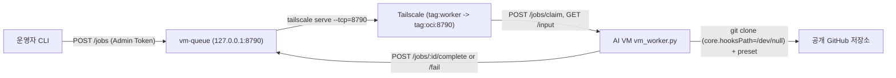

# vm-queue

Tailscale ACL로 격리된 Pull 큐 서버(`Bun` + `SQLite WAL`)와 일회성 AI VM(`x86_64` 8코어)에서 실행하는 무의존 Python 워커 모음입니다.

임시 AI VM에 SSH 키나 개인 시크릿을 두지 않고 상시 서버의 허용 목록 기반 작업(`probe`, `repo_check`)만 꺼내 실행한 뒤 결과 JSON만 돌려받도록 설계했습니다.

## 아키텍처

```
+-----------------------+        Tailscale (tag:worker -> tag:oci tcp:8790)       +-------------------------+
| 일회성 AI VM (Worker) |  ---------------------------------------------------->  | 상시 서버 (127.0.0.1:8790) |
| x86_64 / Python 3     |   POST /jobs/claim, GET /input, heartbeat, complete    | Bun HTTP + SQLite WAL   |
+-----------------------+                                                         +-------------------------+
                                                                                              ^
                                                                                              | Admin Bearer
                                                                                  +-------------------------+
                                                                                  | 운영자 / CLI (127.0.0.1) |
                                                                                  +-------------------------+
```



## 핵심 기능과 보안 경계

- **Pull 전용 구조**: 서버가 일회성 VM으로 SSH 접속하지 않고 워커가 `tailscale serve --tcp=8790` 포트로 작업을 가져갑니다.
- **최소 네트워크 권한**: `docs/tailscale-acl.json`의 `"acls": []`와 `"grants"` 조합으로 `tag:worker`가 `tag:oci`의 `tcp:8790` 외 포트(`22`, 내부 API 등)에 닿지 못하게 막습니다.
- **임의 셸 명령 차단**: `kind`는 `probe`와 `repo_check`만 허용하며 `repo_check`도 `auto` 또는 고정 프리셋(`git_info`, `bun_test`, `bun_check`, `pytest`, `go_test`, `cargo_test`)과 공개 GitHub HTTPS URL만 받습니다.
- **프리셋 자동 선택(`auto`)과 안전 폴백**: 프리셋을 생략하거나 `auto`를 지정하면 워커가 `package.json`·`pyproject.toml`·`go.mod`·`Cargo.toml`과 설치된 런타임을 판별해 실행하고 런타임이 없으면 `git_info`로 자동 폴백합니다.
- **워커 생존 감지와 유한 세션 폴링**: `GET /workers/status`와 `POST /workers/ping`으로 워커 온라인 여부를 확인합니다. 무료 AI VM 계정 정지를 막으려고 24시간 휴면 방지는 두지 않으며 `--mode poll --max-idle-sec 1800`(상한 3600초)으로 작업 시간 동안만 자동 대기합니다.
- **격리 실행과 시크릿 보호**: `vm_worker.py`는 `core.hooksPath=/dev/null`로 클론하고 자식 프로세스 환경변수에서 `VM_QUEUE_*`·API 키를 지웁니다. 서버 역시 출력의 시크릿 패턴을 `422`로 거부합니다.
- **시크릿 비노출 인증 진단**: `401`/`403` 발생 시 토큰 문자열 없이 실패 사유와 형식 플래그(`double_bearer`, `env_key_prefix`, `angle_brackets` 등)만 `journald`에 기록합니다.

## 빠른 시작

### 1. 서버 실행

```bash
cp .env.example .env
# .env에 24자 이상의 서로 다른 관리자·워커 랜덤 토큰을 설정합니다.
bun run index.ts
```

### 2. 작업 등록·자동 오프로드·워커 상태 조회 (`cli/vm-queue-cli.ts`)

```bash
# 시스템 점검 작업 등록
bun run cli/vm-queue-cli.ts submit-probe --job-id poc-probe-1

# 공개 GitHub 저장소 자동 판별(auto) 오프로드 (워커가 온라인이면 완료까지 대기)
bun run cli/vm-queue-cli.ts offload \
  --repo https://github.com/example-org/sample-repo \
  --ref main

# 프리셋 생략 등록(기본 auto) 및 워커 생존 상태 확인
bun run cli/vm-queue-cli.ts submit-repo-check \
  --job-id check-sample-1 \
  --repo https://github.com/example-org/sample-repo
bun run cli/vm-queue-cli.ts workers --window 90

# 상태 조회·목록·재큐잉
bun run cli/vm-queue-cli.ts status check-sample-1
bun run cli/vm-queue-cli.ts list
bun run cli/vm-queue-cli.ts requeue check-sample-1 --ttl 3600
```

### 3. 일회성 AI VM에서 원라인 실행 (`worker/vm_worker.py`)

워커 VM에서는 토큰을 환경변수(`VM_QUEUE_WORKER_TOKEN`)에 담아 실행하면 `--mode drain`이 큐가 빌 때까지 작업을 처리하고 종료합니다. 작업 중 30분 동안 봇이 넣는 작업을 자동으로 받아 처리하려면 `--mode poll --max-idle-sec 1800`을 씁니다.

```bash
curl -fsSL https://raw.githubusercontent.com/gimso2x/vm-queue/main/worker/vm_worker.py -o /tmp/vm_worker.py && python3 /tmp/vm_worker.py --url http://100.64.0.10:8790 --mode poll --max-idle-sec 1800
```

## 테스트

```bash
bun test
python3 -m unittest discover -s worker -v
bash -n scripts/check-tailscale-isolation.sh scripts/print-worker-token.sh
```

## 상세 문서

- [구축 가이드](docs/setup-guide.md): Tailscale ACL 설정, 서버 설치, 격리 게이트, `repo_check` 실전 운용 순서
- [트러블슈팅](docs/troubleshooting.md): 실제 구축 과정에서 겪은 7가지 시행착오 원인과 재발 방지책
